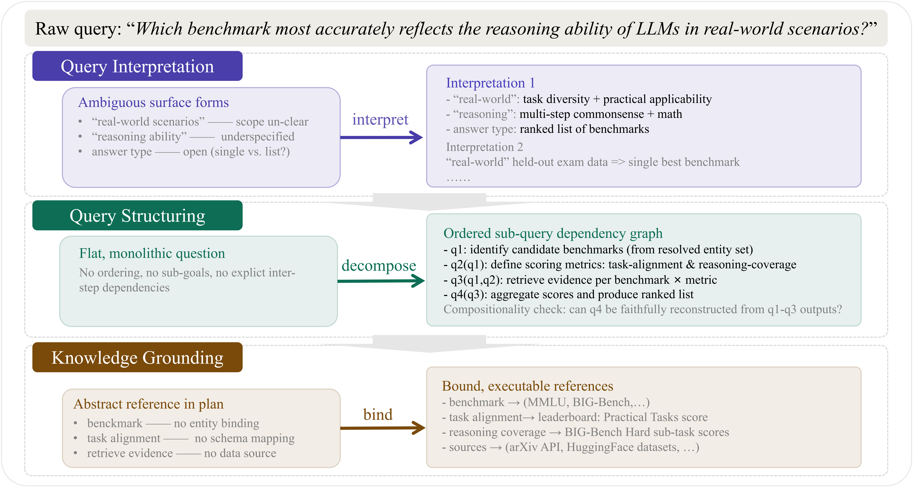
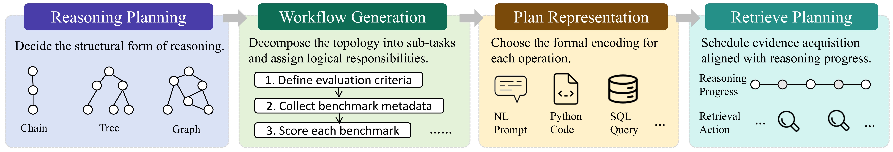
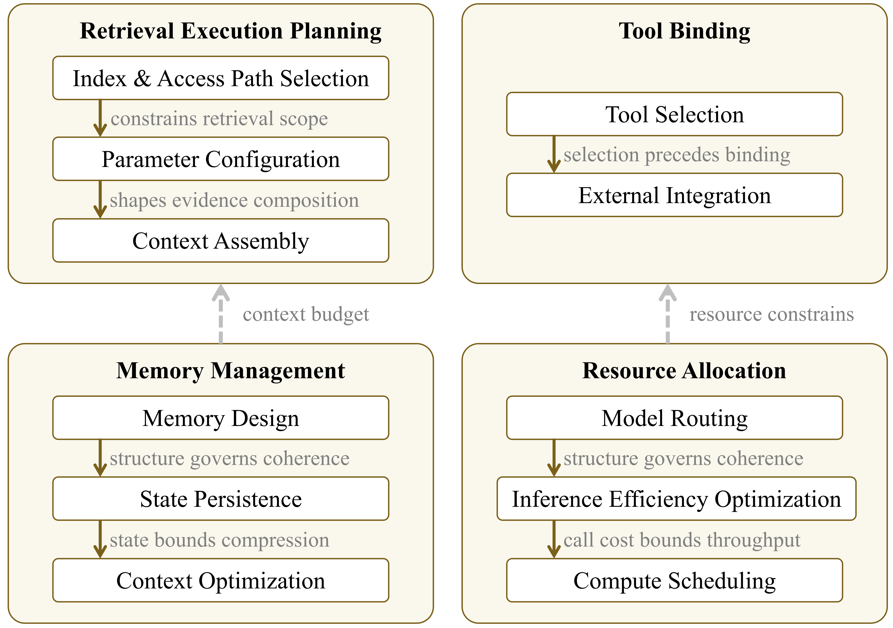
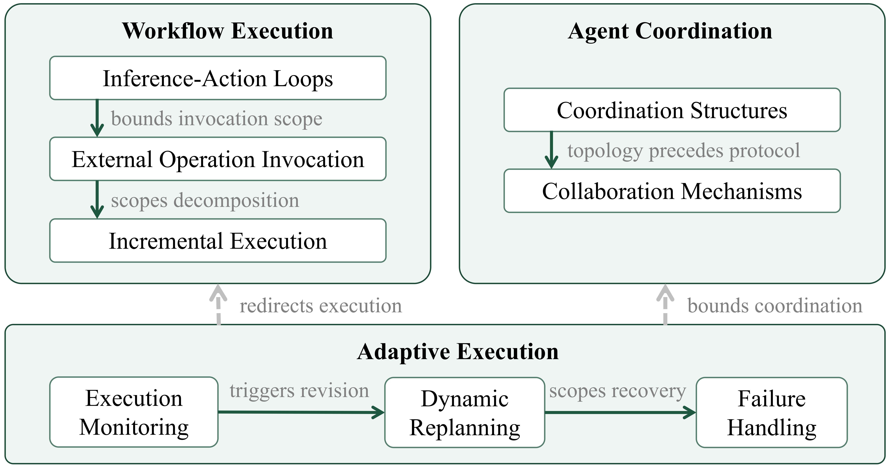
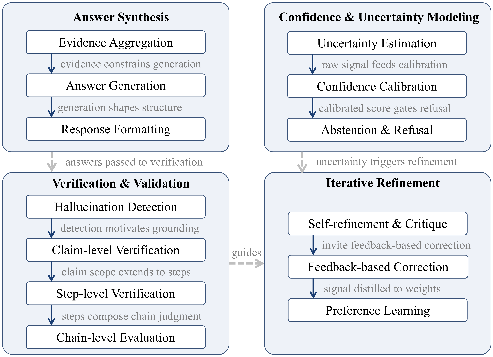

# 📖 A Survey of LLM-Powered Question Answering through the Lens of Query Processing

------

## 🌟 Overview

Large Language Models (LLMs) have fundamentally transformed Question Answering (QA). Modern QA systems no longer answer questions through simple retrieval and generation alone. Instead, they often retrieve evidence from multiple sources, perform multi-step reasoning, invoke external tools, execute intermediate computations, and verify results before producing a final answer.

As QA systems become increasingly sophisticated, understanding them through isolated components—such as retrieval, reasoning, planning, or agents—becomes insufficient. What is often missing is a unified perspective on **how these components interact within a complete end-to-end pipeline**.

Inspired by decades of research in **database query processing**, our survey revisits LLM-powered QA from a systems perspective and studies how a natural language question is progressively transformed into a verified answer through a sequence of coordinated processing stages.

This repository accompanies our survey paper and provides a curated collection of representative systems, taxonomies, and research papers organized through this query processing perspective.

------

## 🎯 A Query Processing Perspective

We organize the literature using a unified **five-stage query processing framework**:

| Stage                      | Objective                                                    |
| -------------------------- | ------------------------------------------------------------ |
| 🔍 Query Rewriting          | Transform ambiguous questions into explicit analytical intents |
| 🧠 Logical Planning         | Construct reasoning workflows and operation dependencies     |
| ⚙️ Physical Planning        | Select concrete tools, models, and data sources              |
| 🚀 Execution & Adaptation   | Execute workflows while adapting to runtime feedback         |
| ✅ Synthesis & Verification | Generate faithful answers and verify supporting evidence     |

This abstraction provides a common language for understanding how modern QA systems process complex analytical questions and highlights the interactions among different stages that ultimately determine system behavior.

------

## 📚 Repository Scope

This repository focuses on **LLM-powered Question Answering systems and methods over textual and tabular data**, two fundamental modalities that represent unstructured and structured information processing, covering representative research primarily published between **2022 and 2026**.

We first analyze representative LLM-powered QA systems to understand how different stages are instantiated and coordinated in practice. Building on this system-level view, we organize the literature around the major design objectives within each stage of the pipeline, as summarized in the taxonomy above. Together, these two perspectives provide a comprehensive view of both end-to-end system architectures and stage-specific research developments.

------

## 🗺️ Table of Contents

* [Pipeline Instantiation in Representative Systems](#pipeline-instantiation-in-representative-systems)
* [Stage 1: Query Rewriting](#stage-1-query-rewriting)
  * [1.1 Query Interpretation](#11-query-interpretation)
  * [1.2 Query Structuring](#12-query-structuring)
  * [1.3 Knowledge Grounding](#13-knowledge-grounding)
* [Stage 2: Logical Planning](#stage2-logical-planning)
  * [2.1 Reasoning Planning](#21-reasoning-planning)
  * [2.2 Workflow Generation](#22-workflow-generation)
  * [2.3 Plan Representation](#23-plan-representation)
  * [2.4 Retrieval Planning](#24-retrieval-planning)

* [Stage 3: Physical Planning](#stage-3-physical-planning)
  * [3.1 Retrieval Execution Planning](#31-retrieval-execution-planning)
  * [3.2 Tool Binding](#32-tool-binding)
  * [3.3 Resource Allocation](#33-resource-allocation)
  * [3.4 Memory Management](#34-memory-management)
  
* [Stage 4: Execution & Adaptation](#stage-4-execution--adaptation)
  * [4.1 Workflow Execution](#41-workflow-execution)
  * [4.2 Agent Coordination](#42-agent-coordination)
  * [4.3 Adaptive Execution](#43-adaptive-execution)

* [Stage 5: Synthesis & Verification](#stage-5-synthesis--verification)
  * [5.1 Answer Synthesis](#answer-synthesis)
  * [5.2 Confidence & Uncertainty Modeling](#confidence--uncertainty-modeling)
  * [5.3 Verification & Validation](#verification--validation)
  * [5.4 Iterative Refinement](#iterative-refinement)

## Pipeline Instantiation in Representative Systems

**Legend:** 🟢 Full | 🟡 Partial | ⚪ None  
**Stages:** QR = Query Rewriting | LP = Logical Planning | PP = Physical Planning | EA = Execution & Adaptation | SV = Synthesis & Verification  

### 🧱 Shift 1 — Early Agentic Systems

| System | Year | Modality | QR | LP | PP | EA | SV |
|--------|------|----------|----|----|----|----|----|
| ReAct [[Paper](https://openreview.net/forum?id=WE_vluYUL-X)] | 2023 | Text | 🟡 | 🟢 | ⚪ | 🟢 | ⚪ |
| Reflexion [[Paper](http://papers.nips.cc/paper_files/paper/2023/hash/1b44b878bb782e6954cd888628510e90-Abstract-Conference.html)] | 2023 | Text | 🟡 | 🟡 | ⚪ | 🟢 | 🟢 |
| MetaGPT [[Paper](https://openreview.net/forum?id=VtmBAGCN7o)] | 2024 | Text | 🟡 | 🟢 | 🟡 | 🟢 | 🟢 |

---

### 🧱 Shift 2 — Explicit Planning Architectures

| System | Year | Modality | QR | LP | PP | EA | SV |
|--------|------|----------|----|----|----|----|----|
| Unify [[Paper](https://www.vldb.org/pvldb/vol18/p5287-wang.pdf)] | 2025 | Text | 🟢 | 🟢 | 🟢 | 🟢 | 🟡 |
| SiriusBI [[Paper](https://www.vldb.org/pvldb/vol18/p4860-xie.pdf)] | 2025 | Tabular | 🟢 | 🟢 | 🟢 | 🟢 | 🟡 |
| ST-Raptor [[Paper](https://doi.org/10.1145/3769829)] | 2025 | Tabular | 🟢 | 🟢 | 🟡 | 🟢 | 🟢 |
| Insight Agents [[Paper](https://doi.org/10.1145/3726302.3731959)] | 2025 | Hybrid | 🟢 | 🟢 | 🟡 | 🟢 | 🟢 |
| MoDora [[Paper](https://dl.acm.org/doi/abs/10.1145/3802089)] | 2026 | Text | 🟢 | 🟢 | 🟢 | 🟢 | 🟡 |

---

### 🧱 Shift 3 — Decoupled Physical Planning

| System | Year | Modality | QR | LP | PP | EA | SV |
|--------|------|----------|----|----|----|----|----|
| DSPy [[Paper](https://proceedings.iclr.cc/paper_files/paper/2024/hash/f1cf02ce09757f57c3b93c0db83181e0-Abstract-Conference.html)] | 2024 | Text | 🟡 | 🟡 | 🟢 | 🟢 | 🟡 |
| Adaptive-RAG [[Paper](https://aclanthology.org/2024.naacl-long.389/)] | 2024 | Text | 🟢 | 🟡 | 🟢 | 🟢 | ⚪ |
| ZenDB [[Paper](https://ieeexplore.ieee.org/abstract/document/11112850/?casa_token=vDSmhp7RSkoAAAAA:bOg9wGTmgotEfFq8czF6lor3R2AjAJW7gViJwyK_X_GDeS5XZJffJwvLDzp58S04zKclTUJi)] | 2025 | Text | 🟢 | 🟢 | 🟢 | 🟢 | ⚪ |
| DocETL [[Paper](https://www.vldb.org/pvldb/vol18/p3035-shankar.pdf)] | 2025 | Text | 🟢 | 🟢 | 🟢 | 🟢 | 🟡 |
| PALIMPZEST [[Paper](https://vldb.org/cidrdb/2025/palimpzest-optimizing-ai-powered-analytics-with-declarative-query-processing.html)] | 2025 | Text | 🟡 | 🟢 | 🟢 | 🟢 | ⚪ |
| Doctopus [[Paper](https://www.vldb.org/pvldb/vol18/p3695-chai.pdf)] | 2025 | Text | 🟡 | 🟢 | 🟢 | 🟢 | ⚪ |
| QUEST [[Paper](https://www.vldb.org/pvldb/vol18/p4560-chai.pdf)] | 2025 | Text | 🟡 | 🟢 | 🟢 | 🟢 | ⚪ |
| LOTUS [[Paper](https://dl.acm.org/doi/abs/10.14778/3749646.3749685)] | 2025 | Hybrid | 🟡 | 🟢 | 🟢 | 🟢 | ⚪ |

---

### 🧱 Shift 4 — Full Pipeline Integration

| System | Year | Modality | QR | LP | PP | EA | SV |
|--------|------|----------|----|----|----|----|----|
| Data Interpreter [[Paper](https://aclanthology.org/2025.findings-acl.1016/)] | 2025 | Hybrid | 🟢 | 🟢 | 🟡 | 🟢 | 🟢 |
| AgenticData [[Paper](https://doi.org/10.48550/arXiv.2508.05002)] | 2025 | Hybrid | 🟢 | 🟢 | 🟢 | 🟢 | 🟢 |
| CompactRAG [[Paper](https://doi.org/10.1145/3774904.3792512)] | 2026 | Text | 🟢 | 🟢 | 🟢 | 🟢 | 🟢 |
| AgenticScholar [[Paper](https://dl.acm.org/doi/abs/10.1145/3802008)] | 2026 | Hybrid | 🟢 | 🟢 | 🟢 | 🟢 | 🟢 |

## Stage 1: Query Rewriting

### 1.1 Query Interpretation
- **AmbigQA: Answering Ambiguous Open-domain Questions** Sewon Min, Julian Michael, Hannaneh Hajishirzi, et al. *EMNLP 2020.* [[Paper](https://doi.org/10.18653/v1/2020.emnlp-main.466)]
- **Learning to Clarify: Multi-turn Conversations with Action-Based Contrastive Self-Training** Maximillian Chen, Ruoxi Sun, Tomas Pfister, et al. *ICLR 2025.* [[Paper](https://openreview.net/forum?id=SIE6VFps9x)]
- **Reasoning About Intent for Ambiguous Requests** Irina Saparina, Mirella Lapata. *arXiv 2025.* [[Paper](https://doi.org/10.48550/arXiv.2511.10453)]
- **LLM-based Query Expansion Fails for Unfamiliar and Ambiguous Queries** Kenya Abe, Kunihiro Takeoka, Makoto P Kato, et al. *SIGIR 2025.* [[Paper](https://doi.org/10.1145/3726302.3730222)]
- **TopiOCQA: Open-domain Conversational Question Answering with Topic Switching** Vaibhav Adlakha, Shehzaad Dhuliawala, Kaheer Suleman, et al. *Transactions of the Association for Computational Linguistics 2022.* [[Paper](https://doi.org/10.1162/tacl_a_00471)]
### 1.2 Query Structuring
- **Break It Down: A Question Understanding Benchmark** Tomer Wolfson, Mor Geva, Ankit Gupta, et al. *Transactions of the Association for Computational Linguistics 2020.* [[Paper](https://doi.org/10.1162/tacl_a_00309)]
- **Least-to-Most Prompting Enables Complex Reasoning in Large Language Models** Denny Zhou, Nathanael Schärli, Le Hou, et al. *ICLR 2023.* [[Paper](https://openreview.net/forum?id=WZH7099tgfM)]
- **Decomposed Prompting: A Modular Approach for Solving Complex Tasks** Tushar Khot, Harsh Trivedi, Matthew Finlayson, et al. *ICLR 2023.* [[Paper](https://openreview.net/forum?id=_nGgzQjzaRy)]
- **Measuring and Narrowing the Compositionality Gap in Language Models** Ofir Press, Muru Zhang, Sewon Min, et al. *Findings of EMNLP 2023.* [[Paper](https://doi.org/10.18653/v1/2023.findings-emnlp.378)]
### 1.3 Knowledge Grounding
- **Query2doc: Query Expansion with Large Language Models** Liang Wang, Nan Yang, Furu Wei. *EMNLP 2023.* [[Paper](https://doi.org/10.18653/v1/2023.emnlp-main.585)]
- **Precise Zero-Shot Dense Retrieval without Relevance Labels** Luyu Gao, Xueguang Ma, Jimmy Lin, et al. *ACL 2023.* [[Paper](https://doi.org/10.18653/v1/2023.acl-long.99)]
- **RESDSQL: Decoupling Schema Linking and Skeleton Parsing for Text-to-SQL** Haoyang Li, Jing Zhang, Cuiping Li, et al. *AAAI 2023.* [[Paper](https://doi.org/10.1609/aaai.v37i11.26535)]
- **DIN-SQL: Decomposed In-Context Learning of Text-to-SQL with Self-Correction** Mohammadreza Pourreza, Davood Rafiei. *NeurIPS 2023.* [[Paper](http://papers.nips.cc/paper_files/paper/2023/hash/72223cc66f63ca1aa59edaec1b3670e6-Abstract-Conference.html)]
- **PICARD: Parsing Incrementally for Constrained Auto-Regressive Decoding from Language Models** Torsten Scholak, Nathan Schucher, Dzmitry Bahdanau. *EMNLP 2021.* [[Paper](https://doi.org/10.18653/v1/2021.emnlp-main.779)]
- **Knapsack Optimization-based Schema Linking for LLM-based Text-to-SQL Generation** Zheng Yuan, Hao Chen, Zijin Hong, et al. *arXiv 2025.* [[Paper](https://dblp.org/img/paper-oa.dark.hollow.16x16.png)]
- **Efficient One-Pass End-to-End Entity Linking for Questions** Belinda Z Li, Sewon Min, Srinivasan Iyer, et al. *EMNLP 2020.* [[Paper](https://doi.org/10.18653/v1/2020.emnlp-main.522)]
- **ReFinED: An Efficient Zero-shot-capable Approach to End-to-End Entity Linking** Tom Ayoola, Shubhi Tyagi, Joseph Fisher, et al. *NAACL (Industry Track) 2022.* [[Paper](https://doi.org/10.18653/v1/2022.naacl-industry.24)]

---

## Stage 2 : Logical Planning

### 2.1 Reasoning Planning

- **Chain-of-Thought Prompting Elicits Reasoning in Large Language Models** Jason Wei, Xuezhi Wang, Dale Schuurmans, et al. *NeurIPS 2022.* [[Paper](http://papers.nips.cc/paper_files/paper/2022/hash/9d5609613524ecf4f15af0f7b31abca4-Abstract-Conference.html)]
- **Large Language Models Are Zero-Shot Reasoners** Takeshi Kojima, Shixiang Shane Gu, Machel Reid, et al. *NeurIPS 2022.* [[Paper](http://papers.nips.cc/paper_files/paper/2022/hash/8bb0d291acd4acf06ef112099c16f326-Abstract-Conference.html)]
- **Self-Consistency Improves Chain of Thought Reasoning in Language Models** Xuezhi Wang, Jason Wei, Dale Schuurmans, et al. *ICLR 2023.* [[Paper](https://dblp.org/img/paper-oa.dark.hollow.16x16.png)]
- **Complexity-Based Prompting for Multi-Step Reasoning** Yao Fu, Hao Peng, Ashish Sabharwal, et al. *ICLR 2023.* [[Paper](https://openreview.net/forum?id=yf1icZHC-l9)]
- **Adaption-of-Thought: Learning Question Difficulty Improves Large Language Models for Reasoning** Mayi Xu, Yongqi Li, Ke Sun, et al. *EMNLP 2024.* [[Paper](https://doi.org/10.18653/v1/2024.emnlp-main.313)]
- **DeepSeek-R1: Incentivizing Reasoning Capability in LLMs via Reinforcement Learning** Daya Guo, Dejian Yang, Haowei Zhang, et al. *arXiv 2025.* [[Paper](https://dblp.org/img/paper-oa.dark.hollow.16x16.png)]
- **Tree of Thoughts: Deliberate Problem Solving with Large Language Models** Shunyu Yao, Dian Yu, Jeffrey Zhao, et al. *NeurIPS 2023.* [[Paper](http://papers.nips.cc/paper_files/paper/2023/hash/271db9922b8d1f4dd7aaef84ed5ac703-Abstract-Conference.html)]
- **Reasoning with Language Model Is Planning with World Model** Shibo Hao, Yi Gu, Haodi Ma, et al. *EMNLP 2023.* [[Paper](https://doi.org/10.18653/v1/2023.emnlp-main.507)]
- **Graph of Thoughts: Solving Elaborate Problems with Large Language Models** Maciej Besta, Nils Blach, Ales Kubicek, et al. *AAAI 2024.* [[Paper](https://doi.org/10.1609/aaai.v38i16.29720)]
- **Think-on-Graph: Deep and Responsible Reasoning of Large Language Model on Knowledge Graph** Jiashuo Sun, Chengjin Xu, Lumingyuan Tang, et al. *arXiv 2023.* [[Paper](https://openreview.net/forum?id=nnVO1PvbTv)]

### 2.2 Workflow Generation

- **HuggingGPT: Solving AI Tasks with ChatGPT and Its Friends in Hugging Face** Yongliang Shen, Kaitao Song, Xu Tan, et al. *NeurIPS 2023.* [[Paper](http://papers.nips.cc/paper_files/paper/2023/hash/77c33e6a367922d003ff102ffb92b658-Abstract-Conference.html)]
- **Plan-and-Solve Prompting: Improving Zero-Shot Chain-of-Thought Reasoning by Large Language Models** Lei Wang, Wanyu Xu, Yihuai Lan, et al. *ACL 2023.* [[Paper](https://doi.org/10.18653/v1/2023.acl-long.147)]
- **MRKL Systems: A Modular, Neuro-Symbolic Architecture That Combines Large Language Models, External Knowledge Sources and Discrete Reasoning** Ehud Karpas, Omri Abend, Yonatan Belinkov, et al. *arXiv 2022.* [[Paper](https://doi.org/10.48550/arXiv.2205.00445)]
- **Toolformer: Language Models Can Teach Themselves to Use Tools** Timo Schick, Jane Dwivedi-Yu, Roberto Dessì, et al. *NeurIPS 2023.* [[Paper](http://papers.nips.cc/paper_files/paper/2023/hash/d842425e4bf79ba039352da0f658a906-Abstract-Conference.html)]
- **DSPy: Compiling Declarative Language Model Calls into State-of-the-Art Pipelines** Omar Khattab, Arnav Singhvi, Paridhi Maheshwari, et al. *ICLR 2024.* [[Paper](https://proceedings.iclr.cc/paper_files/paper/2024/hash/f1cf02ce09757f57c3b93c0db83181e0-Abstract-Conference.html)]
- **Self-RAG: Learning to Retrieve, Generate, and Critique Through Self-Reflection** Akari Asai, Zeqiu Wu, Yizhong Wang, et al. *ICLR 2024.* [[Paper](https://proceedings.iclr.cc/paper_files/paper/2024/hash/25f7be9694d7b32d5cc670927b8091e1-Abstract-Conference.html)]
- **Adaptive-RAG: Learning to Adapt Retrieval-Augmented Large Language Models Through Question Complexity** Soyeong Jeong, Jinheon Baek, Sukmin Cho, et al. *NAACL-HLT 2024.* [[Paper](https://aclanthology.org/2024.naacl-long.389/)]

### 2.3 Plan Representation

- **PAL: Program-Aided Language Models** Luyu Gao, Aman Madaan, Shuyan Zhou, et al. *ICML 2023.* [[Paper](https://proceedings.mlr.press/v202/gao23f.html)]
- **Program of Thoughts Prompting: Disentangling Computation from Reasoning for Numerical Reasoning Tasks** Wenhu Chen, Xueguang Ma, Xinyi Wang, et al. *Transactions on Machine Learning Research 2023.* [[Paper](https://openreview.net/forum?id=YfZ4ZPt8zd)]
- **TAPEX: Table Pre-Training via Learning a Neural SQL Executor** Qian Liu, Bei Chen, Jiaqi Guo, et al. *ICLR 2022.* [[Paper](https://openreview.net/forum?id=O50443AsCP)]
- **Binding Language Models in Symbolic Languages** Zhoujun Cheng, Tianbao Xie, Peng Shi, et al. *ICLR 2023.* [[Paper](https://openreview.net/forum?id=lH1PV42cbF)]
- **SUQL: Conversational Search over Structured and Unstructured Data with Large Language Models** Shicheng Liu, Jialiang Xu, Wesley Tjangnaka, et al. *Findings of NAACL 2024.* [[Paper](https://doi.org/10.18653/v1/2024.findings-naacl.283)]
- **ToRA: A Tool-Integrated Reasoning Agent for Mathematical Problem Solving** Zhibin Gou, Zhihong Shao, Yeyun Gong, et al. *ICLR 2024.* [[Paper](https://openreview.net/forum?id=Ep0TtjVoap)]
- **Creator: Tool Creation for Disentangling Abstract and Concrete Reasoning of Large Language Models** Cheng Qian, Chi Han, Yi Fung, et al. *Findings of EMNLP 2023.* [[Paper](https://doi.org/10.18653/v1/2023.findings-emnlp.462)]

### 2.4 Retrieval Planning

- **Dense Passage Retrieval for Open-Domain Question Answering** Vladimir Karpukhin, Barlas Oguz, Sewon Min, et al. *EMNLP 2020.* [[Paper](https://doi.org/10.18653/v1/2020.emnlp-main.550)]
- **Interleaving Retrieval with Chain-of-Thought Reasoning for Knowledge-Intensive Multi-Step Questions** Harsh Trivedi, Niranjan Balasubramanian, Tushar Khot, et al. *ACL 2023.* [[Paper](https://doi.org/10.18653/v1/2023.acl-long.557)]
- **Active Retrieval Augmented Generation** Zhengbao Jiang, Frank F Xu, Luyu Gao, et al. *EMNLP 2023.* [[Paper](https://doi.org/10.18653/v1/2023.emnlp-main.495)]
- **MBA-RAG: A Bandit Approach for Adaptive Retrieval-Augmented Generation Through Question Complexity** Xiaqiang Tang, Qiang Gao, Jian Li, et al. *COLING 2025.* [[Paper](https://aclanthology.org/2025.coling-main.218/)]

---

## Stage 3: Physical Planning

### 3.1 Retrieval Execution Planning

<h4 style="color: #6c757d;">Index & Access Path Selection</h4>

- **ColBERT: Efficient and Effective Passage Search via Contextualized Late Interaction over BERT** Omar Khattab, Matei Zaharia. *SIGIR 2020.* [[Paper](https://doi.org/10.1145/3397271.3401075)]
- **SPLADE: Sparse Lexical and Expansion Model for First Stage Ranking** Thibault Formal, Benjamin Piwowarski, Stéphane Clinchant. *SIGIR 2021.* [[Paper](https://doi.org/10.1145/3404835.3463098)]
- **QUEST: Query Optimization in Unstructured Document Analysis** Zhaoze Sun, Chengliang Chai, Qiyan Deng, et al. *Proc. VLDB Endow. 2025.* [[Paper](https://www.vldb.org/pvldb/vol18/p4560-chai.pdf)]
- **DocDB: A Database for Unstructured Document Analysis** Zequn Li, Yuanhao Zhong, Chengliang Chai, et al. *Proc. VLDB Endow. 2025.* [[Paper](https://www.vldb.org/pvldb/vol18/p5387-chai.pdf)]

<h4 style="color: #6c757d;">Parameter Configuration</h4>

- **Searching for Best Practices in Retrieval-Augmented Generation** Xiaohua Wang, Zhenghua Wang, Xuan Gao, et al. *EMNLP 2024.* [[Paper](https://doi.org/10.18653/v1/2024.emnlp-main.981)]
- **Doctopus: Budget-aware Structural Table Extraction from Unstructured Documents** Chengliang Chai, Jiajun Li, Yuhao Deng, et al. *Proc. VLDB Endow. 2025.* [[Paper](https://www.vldb.org/pvldb/vol18/p3695-chai.pdf)]

<h4 style="color: #6c757d;">Context Assembly</h4>

- **Lost in the Middle: How Language Models Use Long Contexts** Nelson F Liu, Kevin Lin, John Hewitt, et al. *Transactions of the Association for Computational Linguistics 2024.* [[Paper](https://doi.org/10.1162/tacl_a_00638)]
- **Improving Passage Retrieval with Zero-Shot Question Generation** Devendra Sachan, Mike Lewis, Mandar Joshi, et al. *EMNLP 2022.* [[Paper](https://doi.org/10.18653/v1/2022.emnlp-main.249)]
- **Task Cascades for Efficient Unstructured Data Processing** Shreya Shankar, Sepanta Zeighami, Aditya Parameswaran. *arXiv 2026.* [[Paper](https://doi.org/10.48550/arXiv.2601.05536)]

### 3.2 Tool Binding

<h4 style="color: #6c757d;">Tool Selection</h4>

- **ToolLLM: Facilitating Large Language Models to Master 16000+ Real-World APIs** Yujia Qin, Shihao Liang, Yining Ye, et al. *arXiv 2023.* [[Paper](https://openreview.net/forum?id=dHng2O0Jjr)]
- **Gorilla: Large Language Model Connected with Massive APIs** Shishir G Patil, Tianjun Zhang, Xin Wang, et al. *NeurIPS 2024.* [[Paper](http://papers.nips.cc/paper_files/paper/2024/hash/e4c61f578ff07830f5c37378dd3ecb0d-Abstract-Conference.html)]
- **API-Bank: A Comprehensive Benchmark for Tool-Augmented LLMs** Minghao Li, Yingxiu Zhao, Bowen Yu, et al. *EMNLP 2023.* [[Paper](https://doi.org/10.18653/v1/2023.emnlp-main.187)]
- **ToolRL: Reward Is All Tool Learning Needs** Cheng Qian, Emre Can Acikgoz, Qi He, et al. *NeurIPS 2025.* [[Paper](https://proceedings.neurips.cc/paper_files/paper/2025/hash/97c5b2707228e7e3fb67e4ecc2e0e607-Abstract-Conference.html)]

<h4 style="color: #6c757d;">External Integration</h4>

- **WebGPT: Browser-assisted question-answering with human feedback** Reiichiro Nakano, Jacob Hilton, Suchir Balaji, et al. *arXiv 2021.* [[Paper](https://arxiv.org/abs/2112.09332)]

### 3.3 Resource Allocation

<h4 style="color: #6c757d;">Model Routing</h4>

- **FrugalGPT: How to Use Large Language Models While Reducing Cost and Improving Performance** Lingjiao Chen, Matei Zaharia, James Zou. *Transactions on Machine Learning Research 2024.* [[Paper](https://openreview.net/forum?id=cSimKw5p6R)]
- **Universal Model Routing for Efficient LLM Inference** Wittawat Jitkrittum, Harikrishna Narasimhan, Ankit Singh Rawat, et al. *arXiv 2025.* [[Paper](https://doi.org/10.48550/arXiv.2502.08773)]
- **Learning to Route LLMs with Confidence Tokens** Yu-Neng Chuang, Prathusha Kameswara Sarma, Parikshit Gopalan, et al. *ICML 2025.* [[Paper](https://proceedings.mlr.press/v267/chuang25b.html)]
- **Adaptive Retrieval-Augmented Generation for Conversational Systems** Xi Wang, Procheta Sen, Ruizhe Li, et al. *Findings of NAACL 2025.* [[Paper](https://doi.org/10.18653/v1/2025.findings-naacl.30)]

<h4 style="color: #6c757d;">Inference Efficiency Optimization</h4>

- **FlashAttention: Fast and Memory-Efficient Exact Attention with IO-Awareness** Tri Dao, Dan Fu, Stefano Ermon, et al. *NeurIPS 2022.* [[Paper](http://papers.nips.cc/paper_files/paper/2022/hash/67d57c32e20fd0a7a302cb81d36e40d5-Abstract-Conference.html)]
- **Fast Inference from Transformers via Speculative Decoding** Yaniv Leviathan, Matan Kalman, Yossi Matias. *ICML 2023.* [[Paper](https://proceedings.mlr.press/v202/leviathan23a.html)]
- **Abacus: A Cost-Based Optimizer for Semantic Operator Systems** Matthew Russo, Chunwei Liu, Sivaprasad Sudhir, et al. *arXiv 2025.* [[Paper](https://www.vldb.org/pvldb/vol19/p1060-russo.pdf)]
- **Semantic Operators and Their Optimization: Enabling LLM-Based Data Processing with Accuracy Guarantees in Lotus** Liana Patel, Siddharth Jha, Melissa Pan, et al. *Proc. VLDB Endow. 2025.* [[Paper](https://www.eecs.umich.edu/courses/cse584/static_files/papers/Semantic_operators.pdf)]

<h4 style="color: #6c757d;">Compute Scheduling</h4>

- **Efficient Memory Management for Large Language Model Serving with PagedAttention** Woosuk Kwon, Zhuohan Li, Siyuan Zhuang, et al. *SOSP 2023.* [[Paper](https://dl.acm.org/doi/abs/10.1145/3600006.3613165)]
- **Batch Query Processing and Optimization for Agentic Workflows** Junyi Shen, Noppanat Wadlom, Yao Lu. *arXiv 2025.* [[Paper](https://doi.org/10.48550/arXiv.2509.02121)]

### 3.4 Memory Management

<h4 style="color: #6c757d;">Memory Design</h4>

- **MemoryBank: Enhancing Large Language Models with Long-Term Memory** Wanjun Zhong, Lianghong Guo, Qiqi Gao, et al. *AAAI 2024.* [[Paper](https://doi.org/10.1609/aaai.v38i17.29946)]
- **Generative Agents: Interactive Simulacra of Human Behavior** Joon Sung Park, Joseph O'Brien, Carrie Jun Cai, et al. *UIST 2023.* [[Paper](https://doi.org/10.1145/3586183.3606763)]
- **HippoRAG: Neurobiologically Inspired Long-Term Memory for Large Language Models** Bernal J Gutiérrez, Yiheng Shu, Yu Gu, et al. *NeurIPS 2024.* [[Paper](http://papers.nips.cc/paper_files/paper/2024/hash/6ddc001d07ca4f319af96a3024f6dbd1-Abstract-Conference.html)]
- **A-Mem: Agentic Memory for LLM Agents** Wujiang Xu, Zujie Liang, Kai Mei, et al. *arXiv 2025.* [[Paper](https://doi.org/10.48550/arXiv.2502.12110)]

<h4 style="color: #6c757d;">State Persistence</h4>

- **MemGPT: Towards LLMs as Operating Systems** Charles Packer, Sarah Wooders, Kevin Lin, et al. *arXiv 2023.* [[Paper](https://doi.org/10.48550/arXiv.2310.08560)]
- **Agentic Memory: Learning Unified Long-Term and Short-Term Memory Management for Large Language Model Agents** Yi Yu, Liuyi Yao, Yuexiang Xie, et al. *arXiv 2026.* [[Paper](https://doi.org/10.48550/arXiv.2601.01885)]

<h4 style="color: #6c757d;">Context Optimization</h4>

- **RECOMP: Improving Retrieval-Augmented LMs with Context Compression and Selective Augmentation** Fangyuan Xu, Weijia Shi, Eunsol Choi. *LCLR 2024.* [[Paper]()]

---

## Stage 4: Execution \& Adaptation

### 4.1 Workflow Execution

<h4 style="color: #6c757d;">Inference-Action Loops</h4>

- **ReAct: Synergizing Reasoning and Acting in Language Models** Shunyu Yao, Jeffrey Zhao, Dian Yu, et al. *ICLR 2023.* [[Paper](https://openreview.net/forum?id=WE_vluYUL-X)]
- **A Real-World WebAgent with Planning, Long Context Understanding, and Program Synthesis** Izzeddin Gur, Hiroki Furuta, Austin V Huang, et al. *ICLR 2024.* [[Paper](https://openreview.net/forum?id=9JQtrumvg8)]
- **ToolChain*: Efficient Action Space Navigation in Large Language Models with A* Search** Yuchen Zhuang, Xiang Chen, Tong Yu, et al. *arXiv 2023.* [[Paper](https://openreview.net/forum?id=B6pQxqUcT8)]

<h4 style="color: #6c757d;">External Operation Invocation</h4>

- **Chain of Code: Reasoning with a Language Model-Augmented Code Emulator** Chengshu Li, Jacky Liang, Andy Zeng, et al. *ICML 2024.* [[Paper](https://proceedings.mlr.press/v235/li24ar.html)]
- **Voyager: An Open-Ended Embodied Agent with Large Language Models** Guanzhi Wang, Yuqi Xie, Yunfan Jiang, et al. *Transactions on Machine Learning Research 2024.* [[Paper](https://openreview.net/forum?id=ehfRiF0R3a)]

<h4 style="color: #6c757d;">Incremental Execution</h4>

- **Successive Prompting for Decomposing Complex Questions** Dheeru Dua, Shivanshu Gupta, Sameer Singh, et al. *EMNLP 2022.* [[Paper](https://doi.org/10.18653/v1/2022.emnlp-main.81)]
- **Unify: A System for Unstructured Data Analytics** Jiayi Wang, Yuan Li, Jianming Wu, et al. *Proc. VLDB Endow. 2025.* [[Paper](https://www.vldb.org/pvldb/vol18/p5287-wang.pdf)]
- **Tool Zero: Training Tool-Augmented LLMs via Pure RL from Scratch** Yirong Zeng, Xiao Ding, Yutai Hou, et al. *Findings of EMNLP 2025.* [[Paper](https://doi.org/10.18653/v1/2025.findings-emnlp.485)]

### 4.2 Agent Coordination

<h4 style="color: #6c757d;">Coordination Structures</h4>

- **MetaGPT: Meta Programming for a Multi-Agent Collaborative Framework** Sirui Hong, Mingchen Zhuge, Jonathan Chen, et al. *ICLR 2024.* [[Paper](https://openreview.net/forum?id=VtmBAGCN7o)]
- **AutoGen: Enabling Next-Gen LLM Applications via Multi-Agent Conversations** Qingyun Wu, Gagan Bansal, Jieyu Zhang, et al. *COLM 2024.* [[Paper](https://openreview.net/forum?id=BAakY1hNKS&utm_source=)]
- **ChatDev: Communicative Agents for Software Development** Chen Qian, Wei Liu, Hongzhang Liu, et al. *ACL 2024.* [[Paper](https://aclanthology.org/2024.acl-long.810/)]
- **Emergent Coordination in Multi-Agent Language Models** Christoph Riedl. *arXiv 2025.* [[Paper](https://arxiv.org/abs/2510.05174)]

<h4 style="color: #6c757d;">Collaboration Mechanisms</h4>

- **Improving Factuality and Reasoning in Language Models through Multiagent Debate** Yilun Du, Shuang Li, Antonio Torralba, et al. *ICML 2024.* [[Paper](https://openreview.net/forum?id=zj7YuTE4t8)]
- **CAMEL: Communicative Agents for "Mind" Exploration of Large Language Model Society** Guohao Li, Hasan Hammoud, Hani Itani, et al. *NeurIPS 2023.* [[Paper](https://proceedings.neurips.cc/paper/2023/hash/a3621ee907def47c1b952ade25c67698-Abstract-Conference.html)]
- **Supporting Our AI Overlords: Redesigning Data Systems to Be Agent-First** Shu Liu, Soujanya Ponnapalli, Shreya Shankar, et al. *arXiv 2025.* [[Paper](https://arxiv.org/abs/2509.00997)]
- **LLM Collaboration with Multi-Agent Reinforcement Learning** Shuo Liu, Tianle Chen, Zeyu Liang, et al. *AAAI 2026.* [[Paper](https://ojs.aaai.org/index.php/AAAI/article/view/40487)]

### 4.3 Adaptive Execution

<h4 style="color: #6c757d;">Execution Monitoring</h4>

- **Check Your Facts and Try Again: Improving Large Language Models with External Knowledge and Automated Feedback** Baolin Peng, Michel Galley, Pengcheng He, et al. *arXiv 2023.* [[Paper](https://doi.org/10.48550/arXiv.2302.12813)]
- **AgentPro: Enhancing LLM Agents with Automated Process Supervision** Yuchen Deng, Shichen Fan, Naibo Wang, et al. *EMNLP 2025.* [[Paper](https://doi.org/10.18653/v1/2025.emnlp-main.506)]

<h4 style="color: #6c757d;">Dynamic Replanning</h4>

- **ExpeL: LLM Agents Are Experiential Learners** Andrew Zhao, Daniel Huang, Quentin Xu, et al. *AAAI 2024.* [[Paper](https://doi.org/10.1609/aaai.v38i17.29936)]
- **Describe, Explain, Plan and Select: Interactive Planning with LLMs Enables Open-World Multi-Task Agents** Zihao Wang, Shaofei Cai, Guanzhou Chen, et al. *NeurIPS 2023.* [[Paper](http://papers.nips.cc/paper_files/paper/2023/hash/6b8dfb8c0c12e6fafc6c256cb08a5ca7-Abstract-Conference.html)]

<h4 style="color: #6c757d;">Failure Handling</h4>

- **Reflexion: Language Agents with Verbal Reinforcement Learning** Noah Shinn, Federico Cassano, Ashwin Gopinath, et al. *NeurIPS 2023.* [[Paper](http://papers.nips.cc/paper_files/paper/2023/hash/1b44b878bb782e6954cd888628510e90-Abstract-Conference.html)]
- **CRITIC: Large Language Models Can Self-Correct with Tool-Interactive Critiquing** Zhibin Gou, Zhihong Shao, Yeyun Gong, et al. *ICLR 2024.* [[Paper](https://openreview.net/forum?id=Sx038qxjek)]
- **FireAct: Toward Language Agent Fine-Tuning** Baian Chen, Chang Shu, Ehsan Shareghi, et al. *arXiv 2023.* [[Paper](https://arxiv.org/abs/2310.05915)]

---

## Stage 5: Synthesis \& Verification

### Answer Synthesis

<h4 style="color: #6c757d;">Evidence Aggregation</h4>

- **Retrieval-Augmented Generation for Knowledge-Intensive NLP Tasks** Patrick Lewis, Ethan Perez, Aleksandra Piktus, et al. *NeurIPS 2020.* [[Paper](https://proceedings.neurips.cc/paper/2020/hash/6b493230205f780e1bc26945df7481e5-Abstract.html)]
- **Leveraging Passage Retrieval with Generative Models for Open Domain Question Answering** Gautier Izacard, Edouard Grave. *EACL 2021.* [[Paper](https://doi.org/10.18653/v1/2021.eacl-main.74)]
- **Language Models That Seek for Knowledge: Modular Search & Generation for Dialogue and Prompt Completion** Kurt Shuster, Mojtaba Komeili, Leonard Adolphs, et al. *Findings of EMNLP 2022.* [[Paper](https://doi.org/10.18653/v1/2022.findings-emnlp.27)]

<h4 style="color: #6c757d;">Answer Generation</h4>

- **Generating Natural Answers by Incorporating Copying and Retrieving Mechanisms in Sequence-to-Sequence Learning** Shizhu He, Cao Liu, Kang Liu, et al. *ACL 2017.* [[Paper](https://doi.org/10.18653/v1/P17-1019)]
- **Unifying Question Answering, Text Classification, and Regression via Span Extraction** Nitish Shirish Keskar, Bryan McCann, Caiming Xiong, et al. *arXiv 2019.* [[Paper](https://arxiv.org/abs/1904.09286)]
- **Training Language Models to Follow Instructions with Human Feedback** Long Ouyang, Jeffrey Wu, Xu Jiang, et al. *NeurIPS 2022.* [[Paper](https://proceedings.neurips.cc/paper/2022/hash/b1efde53be364a73914f58805a001731-Abstract.html)]
- **MatPlotAgent: Method and Evaluation for LLM-Based Agentic Scientific Data Visualization** Zhiyu Yang, Zihan Zhou, Shuo Wang, et al. *Findings of ACL 2024.* [[Paper](https://aclanthology.org/2024.findings-acl.701/)]

<h4 style="color: #6c757d;">Response Formatting</h4>

- **Attributed Question Answering: Evaluation and Modeling for Attributed Large Language Models** Bernd Bohnet, Vinh Q Tran, Pat Verga, et al. *arXiv 2022.* [[Paper](https://arxiv.org/abs/2212.08037)]
- **Divide-Verify-Refine: Can LLMs Self-Align with Complex Instructions?** Xianren Zhang, Xianfeng Tang, Hui Liu, et al. *Findings of ACL 2025.* [[Paper](https://aclanthology.org/2025.findings-acl.709/)]

### Confidence & Uncertainty Modeling

<h4 style="color: #6c757d;">Uncertainty Estimation</h4>

- **Teaching Models to Express Their Uncertainty in Words** Stephanie Lin, Jacob Hilton, Owain Evans. *Transactions on Machine Learning Research 2022.* [[Paper](https://openreview.net/forum?id=8s8K2UZGTZ)]
- **Language Models (Mostly) Know What They Know** Saurav Kadavath, Tom Conerly, Askell Amanda, et al. *arXiv 2022.* [[Paper](https://arxiv.org/abs/2207.05221)]
- **Semantic Uncertainty: Linguistic Invariances for Uncertainty Estimation in Natural Language Generation** Lorenz Kuhn, Yarin Gal, Sebastian Farquhar. *ICLR 2023.* [[Paper](https://openreview.net/forum?id=VD-AYtP0dve)]

<h4 style="color: #6c757d;">Confidence Calibration</h4>

- **Calibrate Before Use: Improving Few-Shot Performance of Language Models** Zihao Zhao, Eric Wallace, Shi Feng, et al. *ICML 2021.* [[Paper](http://proceedings.mlr.press/v139/zhao21c.html)]
- **Just Ask for Calibration: Strategies for Eliciting Calibrated Confidence Scores from Language Models Fine-Tuned with Human Feedback** Katherine Tian, Eric Mitchell, Allan Zhou, et al. *EMNLP 2023.* [[Paper](https://aclanthology.org/2023.emnlp-main.330/)]
- **Calibrating Large Language Models Using Their Generations Only** Dennis Ulmer, Martin Gubri, Hwaran Lee, et al. *ACL 2024.* [[Paper](https://doi.org/10.18653/v1/2024.acl-long.824)]

<h4 style="color: #6c757d;">Abstention & Refusal</h4>

- **Know What You Don’t Know: Unanswerable Questions for SQuAD** Pranav Rajpurkar, Robin Jia, Percy Liang. *ACL 2018.* [[Paper](https://aclanthology.org/P18-2124/)]
- **R-Tuning: Instructing Large Language Models to Say ‘I Don’t Know’** Hanning Zhang, Shizhe Diao, Yong Lin, et al. *NAACL-HLT 2024.* [[Paper](https://doi.org/10.18653/v1/2024.naacl-long.394)]

### Verification & Validation

<h4 style="color: #6c757d;">Hallucination Detection</h4>

- **SelfCheckGPT: Zero-Resource Black-Box Hallucination Detection for Generative Large Language Models** Potsawee Manakul, Adian Liusie, Mark Gales. *EMNLP 2023.* [[Paper](https://doi.org/10.18653/v1/2023.emnlp-main.557)]
- **Inference-Time Intervention: Eliciting Truthful Answers from a Language Model** Kenneth Li, Oam Patel, Fernanda Viégas, et al. *NeurIPS 2023.* [[Paper](http://papers.nips.cc/paper_files/paper/2023/hash/81b8390039b7302c909cb769f8b6cd93-Abstract-Conference.html)]
- **Rowen: Adaptive Retrieval-Augmented Generation for Hallucination Mitigation in LLMs** Hanxing Ding, Liang Pang, Zihao Wei, et al. *SIGIR-AP 2025.* [[Paper](https://doi.org/10.1145/3767695.3769500)]

<h4 style="color: #6c757d;">Claim-Level Verification</h4>

- **FactScore: Fine-Grained Atomic Evaluation of Factual Precision in Long Form Text Generation** Sewon Min, Kalpesh Krishna, Xinxi Lyu, et al. *EMNLP 2023.* [[Paper](https://doi.org/10.18653/v1/2023.emnlp-main.741)]
- **Verify-and-Edit: A Knowledge-Enhanced Chain-of-Thought Framework** Ruochen Zhao, Xingxuan Li, Shafiq Joty, et al. *ACL 2023.* [[Paper](https://doi.org/10.18653/v1/2023.acl-long.320)]

<h4 style="color: #6c757d;">Step-Level Verification</h4>

- **Let’s Verify Step by Step** Hunter Lightman, Vineet Kosaraju, Yuri Burda, et al. *ICLR 2024.* [[Paper](https://openreview.net/forum?id=v8L0pN6EOi)]
- **Math-Shepherd: Verify and Reinforce LLMs Step-by-Step Without Human Annotations** Peiyi Wang, Lei Li, Zhihong Shao, et al. *ACL 2024.* [[Paper](https://doi.org/10.18653/v1/2024.acl-long.510)]
- **DS-Agent: Automated Data Science by Empowering Large Language Models with Case-Based Reasoning** Siyuan Guo, Cheng Deng, Ying Wen, et al. *ICML 2024.* [[Paper](https://proceedings.mlr.press/v235/guo24b.html)]

<h4 style="color: #6c757d;">Chain-Level Evaluation</h4>

- **Judging LLM-as-a-Judge with MT-Bench and Chatbot Arena** Lianmin Zheng, Wei-Lin Chiang, Ying Sheng, et al. *NeurIPS 2023.* [[Paper](http://papers.nips.cc/paper_files/paper/2023/hash/91f18a1287b398d378ef22505bf41832-Abstract-Datasets_and_Benchmarks.html)]
- **G-Eval: NLG Evaluation Using GPT-4 with Better Human Alignment** Yang Liu, Dan Iter, Yichong Xu, et al. *EMNLP 2023.* [[Paper](https://doi.org/10.18653/v1/2023.emnlp-main.153)]
- **Tuning LLM Judge Design Decisions for 1/1000 of the Cost** David Salinas, Omar Swelam, Frank Hutter. *ICML 2025.* [[Paper](https://proceedings.mlr.press/v267/salinas25a.html)]

### Iterative Refinement

<h4 style="color: #6c757d;">Self-Refinement & Critique</h4>

- **Self-Refine: Iterative Refinement with Self-Feedback** Aman Madaan, Niket Tandon, Prakhar Gupta, et al. *NeurIPS 2023.* [[Paper](http://papers.nips.cc/paper_files/paper/2023/hash/91edff07232fb1b55a505a9e9f6c0ff3-Abstract-Conference.html)]
- **Reflexion: Language Agents with Verbal Reinforcement Learning** Noah Shinn, Federico Cassano, Ashwin Gopinath, et al. *NeurIPS 2023.* [[Paper](http://papers.nips.cc/paper_files/paper/2023/hash/1b44b878bb782e6954cd888628510e90-Abstract-Conference.html)]
- **Constitutional AI: Harmlessness from AI Feedback** Yuntao Bai, Saurav Kadavath, Sandipan Kundu, et al. *arXiv 2022.* [[Paper](https://doi.org/10.48550/arXiv.2212.08073)]

<h4 style="color: #6c757d;">Feedback-Based Correction</h4>

- **CRITIC: Large Language Models Can Self-Correct with Tool-Interactive Critiquing** Zhibin Gou, Zhihong Shao, Yeyun Gong, et al. *ICLR 2024.* [[Paper](https://openreview.net/forum?id=Sx038qxjek)]
- **Generating with Confidence: Uncertainty Quantification for Black-Box Large Language Models** Zhen Lin, Shubhendu Trivedi, Jimeng Sun. *Transactions on Machine Learning Research 2024.* [[Paper](https://openreview.net/forum?id=DWkJCSxKU5)]

<h4 style="color: #6c757d;">Preference Learning</h4>

- **Direct Preference Optimization: Your Language Model Is Secretly a Reward Model** Rafael Rafailov, Archit Sharma, Eric Mitchell, et al. *NeurIPS 2023.* [[Paper](http://papers.nips.cc/paper_files/paper/2023/hash/a85b405ed65c6477a4fe8302b5e06ce7-Abstract-Conference.html)]
- **RLHF-V: Towards Trustworthy MLLMs via Behavior Alignment from Fine-Grained Correctional Human Feedback** Tianyu Yu, Yuan Yao, Haoye Zhang, et al. *CVPR 2024.* [[Paper](https://doi.org/10.1109/CVPR52733.2024.01310)]
- **Learning from Self Critique and Refinement for Faithful LLM Summarization** Ting-Yao Hu, Hema Swetha Koppula, Hadi Pouransari, et al. *arXiv 2025.* [[Paper](https://doi.org/10.48550/arXiv.2512.05387)]

